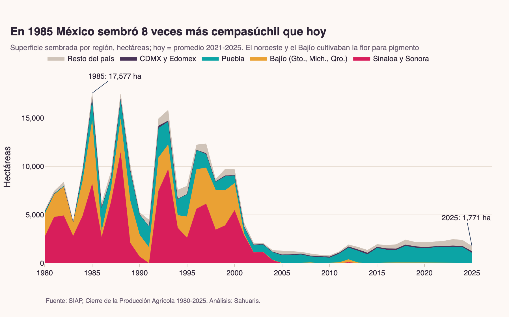
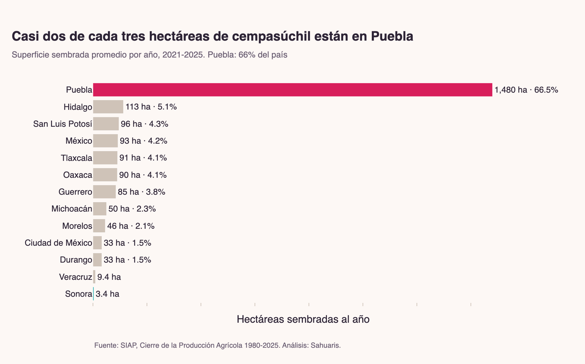
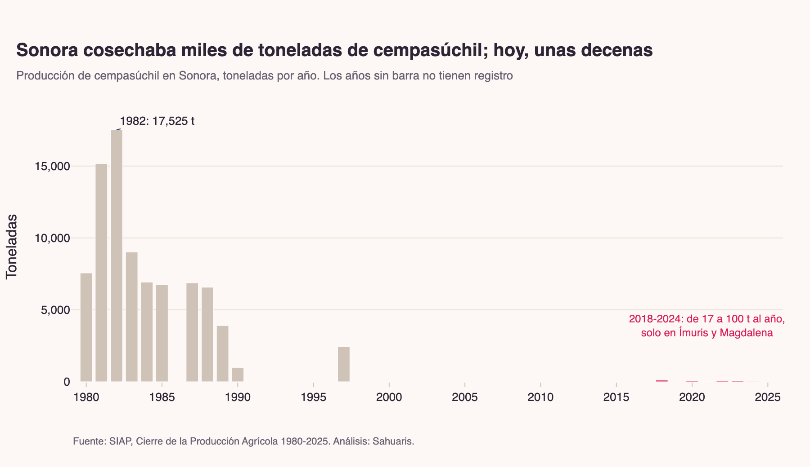
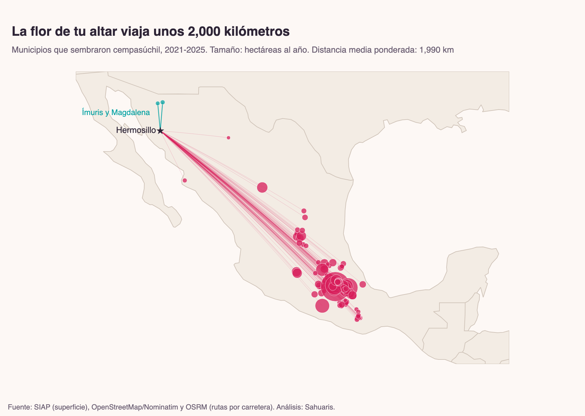
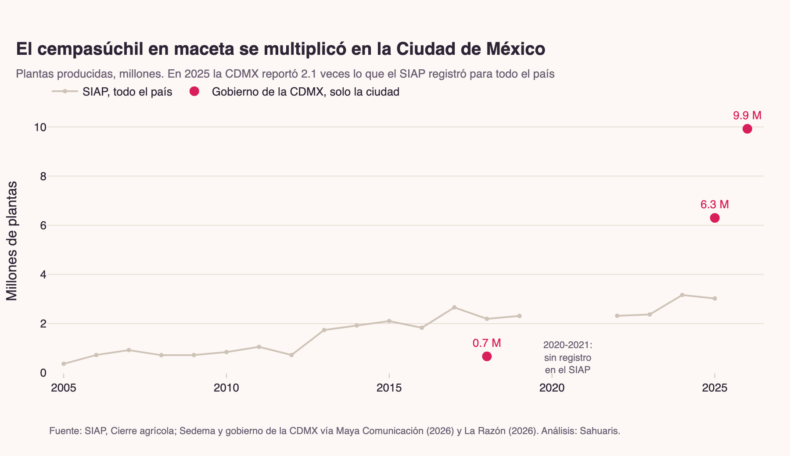

# La flor que México le prestó al mundo

Investigación de datos de **Sahuaris** (data storytelling en español) sobre el cempasúchil: de dónde viene la flor que llega a los altares de Día de Muertos, cómo cambió su cultivo desde 1980 y qué queda en Sonora.



## Hallazgos

Cada afirmación se recalcula y se verifica con `assert` en [`06_sintesis_y_verificacion`](notebooks/06_sintesis_y_verificacion.ipynb); el resultado queda en [`outputs/tablas/insights_verificados.csv`](outputs/tablas/insights_verificados.csv).

1. **Puebla siembra el 66 %** del cempasúchil del país (2,227 ha al año en promedio, 2021-2025).
2. **En 1985 México sembró 17,577 ha, ocho veces más que hoy.** En los 80, Sinaloa, Sonora y el Bajío tenían el 83 % de la superficie; hoy, el 2.5 %. Esa flor era materia prima para el pigmento de la yema del huevo, una industria que se fue a China, Perú e India.
3. **El último cempasúchil forrajero que registra el SIAP es de 2001**, en Sinaloa.
4. **Sonora cosechó 17,525 t en 1982** (15 % del país). Entre 2018 y 2024 registró de 17 a 100 t, solo en Ímuris y Magdalena; en 2025, nada.
5. **La flor sembrada en México está, en promedio, a 1,990 km por carretera de Hermosillo.** Solo el 0.24 % de la superficie está a menos de 500 km.
6. **Las plantas en maceta se multiplicaron** (0.36 a 3.02 millones en el SIAP, 2005-2025; 9.9 millones solo en la CDMX en 2026), y el 99 % de la semilla de maceta es importada, sobre todo de Estados Unidos (Consejo Mexicano de la Flor).

| | |
|---|---|
|  |  |
|  |  |

Las versiones interactivas (Plotly, con tooltips) están en [`outputs/figuras/*.html`](outputs/figuras/).

## Notebooks

| # | Notebook | Pregunta |
|---|---|---|
| 00 | [Fuentes y descarga](notebooks/00_fuentes_y_descarga.ipynb) | ¿Qué datos usamos y qué tan completos son? |
| 01 | [Dónde se cultiva hoy](notebooks/01_donde_se_cultiva_hoy.ipynb) | ¿Qué estados y municipios siembran cempasúchil? |
| 02 | [Cuatro décadas](notebooks/02_cuatro_decadas.ipynb) | ¿Cómo cambió la producción desde 1980? |
| 03 | [Sonora](notebooks/03_sonora.ipynb) | ¿Cuánto produjo y produce Sonora? |
| 04 | [El viaje a Hermosillo](notebooks/04_el_viaje_a_hermosillo.ipynb) | ¿Qué tan lejos crece la flor? |
| 05 | [La maceta y la semilla](notebooks/05_la_maceta_y_la_semilla.ipynb) | ¿Cómo cambió la forma de vender la flor? |
| 06 | [Síntesis y verificación](notebooks/06_sintesis_y_verificacion.ipynb) | ¿Se sostiene cada afirmación? |

## Reproducir

Requiere [uv](https://docs.astral.sh/uv/) y Python 3.12.

```bash
uv sync
uv run python main.py                      # descarga (~150 MB), procesa y ejecuta los 7 notebooks
uv run python main.py --sin-descarga       # si datos/raw/ ya existe
uv run python -m src.descarga --solo siap  # una sola fuente
```

`datos/raw/` no se versiona; todo lo demás se regenera desde ahí.

## Estructura

```
├── main.py                    pipeline: descarga → tablas → notebooks
├── src/
│   ├── config.py              rutas, URLs del SIAP, regiones
│   ├── descarga.py            descarga reanudable (SIAP, Nominatim + OSRM)
│   ├── procesamiento.py       homologación de los cierres agrícolas 1980-2025
│   └── tema.py                identidad visual de Sahuaris para Plotly
├── notebooks/                 00-06, ejecutados y con salidas
├── datos/
│   ├── raw/                   (no versionado) descargas originales
│   ├── manual/                cifras de prensa y literatura, con URL
│   └── processed/             tablas limpias
├── outputs/
│   ├── figuras/               PNG (2x) e HTML interactivo de cada gráfica
│   └── tablas/                insights verificados
├── research_notes/            investigación documental con todas las fuentes
└── docs/plans/                diseño de la investigación
```

## Fuentes

| Fuente | Qué aporta | Acceso |
|---|---|---|
| [SIAP, Cierre de la Producción Agrícola](https://nube.agricultura.gob.mx/datosAbiertos/Agricola.php) | Superficie, producción y valor del cempasúchil por estado (1980-2002) y municipio (2003-2025) | CSV abierto |
| [OpenStreetMap / Nominatim](https://nominatim.openstreetmap.org/) | Coordenadas de los municipios productores | API abierta |
| [OSRM](https://project-osrm.org/) | Distancia y tiempo por carretera a Hermosillo | API abierta |
| Prensa y literatura | Industria del pigmento, China, semilla importada, Ímuris | [`research_notes/`](research_notes/01_investigacion_documental.md) |

## Limitaciones

- El SIAP registra dónde se siembra la flor, no a dónde se vende.
- Antes de 2003 solo hay datos estatales.
- Las plantas en maceta no tienen registro en 2020-2021, y el SIAP cuenta menos que el gobierno de la CDMX.
- No hay estadística abierta del cempasúchil industrial en China, India o Perú; esas cifras son documentales.
